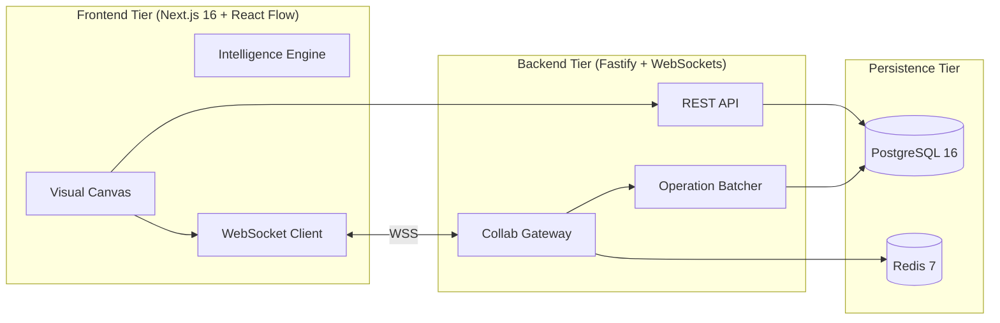

# Onelogica — Collaborative Architecture & Workflow Designer

> A real-time collaborative platform to create, edit, share, and manage technical architecture diagrams, flowcharts, and workflows. Built with Next.js, Fastify, React Flow, WebSockets, and PostgreSQL.

---

## Table of Contents

- [Features Overview](#features-overview)
- [Architecture & Tech Stack](#architecture--tech-stack)
- [Monorepo Structure](#monorepo-structure)
- [Getting Started](#getting-started)
- [Zero-Config Local Evaluation Mode](#zero-config-local-evaluation-mode)
- [Running Automated Tests](#running-automated-tests)
- [Deployment & Tunneling](#deployment--tunneling)
- [Engineering Edge Cases](#engineering-edge-cases)
- [Demo Script & Walkthrough](#demo-script--walkthrough)

---

## Features Overview

### 1. Authentication & Access Management (Activity 1)
- **Firebase Authentication**: Email/Password registration & login + Google OAuth.
- **Protected Routes**: Middleware session verification protecting `/workspace/*`.
- **Diagram Permissions & RBAC**: Diagrams are strictly scoped by ownership and granular collaborator permissions (`OWNER`, `EDITOR`, `VIEWER`).
- **Collaborator Management**: Invite collaborators by email and revoke permissions in real time.

### 2. Visual Diagram Editor (Activity 2)
- **Drag-and-Drop Palette**: Draggable architectural primitives (Microservice, Client, Database, Cloud Provider, Decision Gateway, VPC Container).
- **Custom Shapes & Resizing**: Interactive bounding `NodeResizer` controls.
- **Dynamic Rotation**: Continuous 0° to 360° rotation slider.
- **Directional Connectors**: SmoothStep, Bezier, and Straight connectors with directional arrowheads and editable connection labels.
- **Property Inspector**: Custom colors (Emerald, Blue, Amber, Purple, Rose, Slate), labels, descriptions, and geometry.
- **Canvas Navigation**: Pan, zoom, multi-selection (Shift + box drag), and interactive MiniMap.
- **Isolated Local Undo/Redo**: History manager with keyboard shortcuts (`Ctrl+Z`, `Ctrl+Y`).
- **Export Formats**: One-click export to PNG (2x retina), SVG, and JSON diagram schema, plus JSON import.

### 3. Diagram Intelligence Engine (Activity 3)
- **Hierarchical Topological Auto-Layout**: Automatically computes dependency ranks and organizes connected nodes into aligned columns and tracks.
- **Circular Dependency Detection**: Depth-First Search (DFS) recursion stack detection that warns and visualizes the exact cycle path (`A → B → C → A`).
- **Disconnected Subsystems Analysis**: Breadth-First Search (BFS) partitions the graph into disjoint connected components, alerting when isolated services exist.
- **Connection Rules & Validation**: Rejects self-links, duplicate edges, and dangling references.
- **Grouping & Nested Components**: Wrap selected nodes into a parent container boundary and ungroup back into canvas coordinates.

### 4. Real-Time Collaboration (Activity 4)
- **Multiplayer Collaboration**: Real-time room editing over WebSockets.
- **Live Collaborator Cursors**: Live mouse cursor broadcasting with distinct user colors and display name tags.
- **Real-Time Operation Sync**: Node movement, creation, resizing, rotation, and edge connections sync instantaneously.
- **Conflict Resolution**: Element-level Last-Write-Wins (LWW) timestamp merging prevents concurrent edits from silently overwriting each other.
- **Disconnection & Reconnection**: Exponential backoff reconnect with automatic `sync-request` snapshot catchup.

### 5. Version History (Activity 5)
- **Milestone Snapshots**: Create named versions with metadata (node and edge counts).
- **Audit Tracking**: Records who made changes and exact timestamps.
- **Version Browser**: View past versions in a dedicated modal.
- **One-Click Restore**: Restores previous diagram state into the canvas and broadcasts the rollback to all connected collaborators.

---

## Architecture & Tech Stack



- **Frontend**: Next.js 16 (App Router), React 19, TypeScript, Tailwind CSS, React Flow v11, html-to-image.
- **Backend**: Node.js, Fastify, `@fastify/websocket`, `@fastify/cors`, Zod, pg.
- **Auth**: Firebase Authentication (Client SDK) + Firebase Admin SDK (with Dev Mock fallback).
- **Database**: PostgreSQL 16 (SQL migrations & Prisma schema).
- **Realtime Coordination**: WebSockets + Redis Pub/Sub support.

---

## Monorepo Structure

```
onelogica/
├── apps/
│   ├── frontend/             # Next.js 16 client application
│   │   ├── src/app/          # App router pages (/login, /workspace, /workspace/[diagramId])
│   │   ├── src/components/   # DiagramEditor, ArchitectureNode, Inspector, Cursors, Modals
│   │   └── src/lib/          # Diagram intelligence, history, firebase, api clients
│   └── backend/              # Fastify API & WebSocket gateway
│       ├── src/routes/       # Diagram CRUD, versions, and permissions endpoints
│       ├── src/realtime/     # WebSocket collaboration gateway & operation batcher
│       ├── src/auth/         # Firebase Admin verification & dev mock token parser
│       └── src/db/           # Resilient PostgreSQL pool with in-memory fallback
├── packages/
│   └── shared-types/         # Shared TypeScript contracts (nodes, operations, presence)
├── infra/
│   ├── migrations/           # 0001_initial_schema.sql (PostgreSQL tables & indexes)
│   └── tunnel/               # Cloudflare Tunnel config & start-tunnel.sh
├── docs/
│   ├── architecture.md       # Comprehensive system architecture & sequence diagrams
│   └── demo.md               # Step-by-step submission demo video recording script
├── netlify.toml              # Netlify deployment configuration
└── docker-compose.yml        # PostgreSQL & Redis containers
```

---

## Getting Started

### Prerequisites

- Node.js >= 20.x
- npm >= 10.x
- Docker & Docker Compose (optional, in-memory fallback is included for local review)

### 1. Installation

```bash
npm install
npm --workspace @onelogica/shared-types run build
```

### 2. (Optional) Start Infrastructure

If you have Docker running locally:
```bash
docker compose up -d
npm --workspace @onelogica/backend run db:migrate
```
*(If Docker is not running, the backend automatically activates an in-memory SQL fallback store so you can evaluate the entire app immediately without any setup).*

### 3. Start Development Servers

Run both frontend and backend concurrently:
```bash
npm run dev
```

- **Frontend**: `http://localhost:3000`
- **Backend**: `http://localhost:8080`

---

## Zero-Config Local Evaluation Mode

To allow immediate testing of multiplayer collaboration across two windows without configuring live Google Cloud / Firebase credentials:

1. Open `http://localhost:3000/login` in your first browser window.
2. Click **"Sign in as Alice"** (or register any email).
3. Open `http://localhost:3000/login` in an Incognito / secondary browser window.
4. Click **"Sign in as Bob"**.
5. Create a diagram, click **"Share"**, invite Bob's email, and open the URL in Bob's window to see real-time collaboration with live cursors!

*When real Firebase credentials are provided in `.env`, the system automatically uses genuine Firebase token verification.*

---

## Running Automated Tests

Run all unit, integration, and performance tests across the entire repository:

```bash
npm test
```

### Test Coverage Highlights
- **Cycle Detection**: Direct cycles, transitive cycles, cycle path reconstruction.
- **Topology & Disconnected Components**: Isolated node detection, component clustering.
- **Hierarchical Auto-Layout**: Topological layering and coordinate assignments.
- **Connection Validation**: Self-loop prevention, duplicate edge rejection.
- **Grouping & Nesting**: Container nesting and coordinate conversion.
- **Scale Benchmark (Activity 6 Scenario 4)**: 1,000+ nodes and 1,200 edges processed under 250ms.
- **Local Undo/Redo (Activity 6 Scenario 5)**: Local command stack isolation.
- **Operation Batcher (Activity 6 Scenario 7)**: In-memory queue flushes and durability.
- **REST Endpoints**: Diagram CRUD, permissions sharing, and version snapshot restore.

---

## Deployment & Tunneling

### Frontend on Netlify
The repository contains [`netlify.toml`](file:///home/shreyanshtiwari/Documents/Onelogica/netlify.toml) configured for Next.js App Router:
- Connect the Git repository to Netlify.
- Build command: `npm run build`
- Publish directory: `apps/frontend/.next`
- Set environment variables: `NEXT_PUBLIC_API_BASE_URL` and `NEXT_PUBLIC_WS_BASE_URL`.

### Backend Access via Cloudflare Tunnel
To expose your local backend securely with HTTPS & WSS:

```bash
./infra/tunnel/start-tunnel.sh
```
Or directly using Cloudflare CLI:
```bash
cloudflared tunnel --url http://localhost:8080
```

---

## Engineering Edge Cases Handled

1. **Two users move the same node simultaneously**: Element-level Last-Write-Wins (LWW) using node timestamps.
2. **One user deletes a node while another edits its connections**: Incident edges are safely pruned; edge validator rejects connections to deleted nodes.
3. **User disconnects for 30s and reconnects**: Exponential backoff reconnects automatically and fetches the latest diagram state via `sync-request`.
4. **Diagram contains 1,000+ nodes and connections**: Sub-quadratic graph algorithms maintain responsive performance; automated test asserts completion under 250ms.
5. **Multiple users perform undo/redo**: Isolated local history stacks ensure undoing only reverses the active user's local actions.
6. **Invalid connections and circular dependencies**: Pre-commit validation and DFS cycle path warning banners.
7. **Frequent diagram changes persisted efficiently**: Fast-path operation batching every 1.5s in the backend + debounced snapshot saves (1.2s) in the frontend.

---

## Demo Script & Walkthrough

For a complete step-by-step video recording guide, see [`docs/demo.md`](file:///home/shreyanshtiwari/Documents/Onelogica/docs/demo.md).
