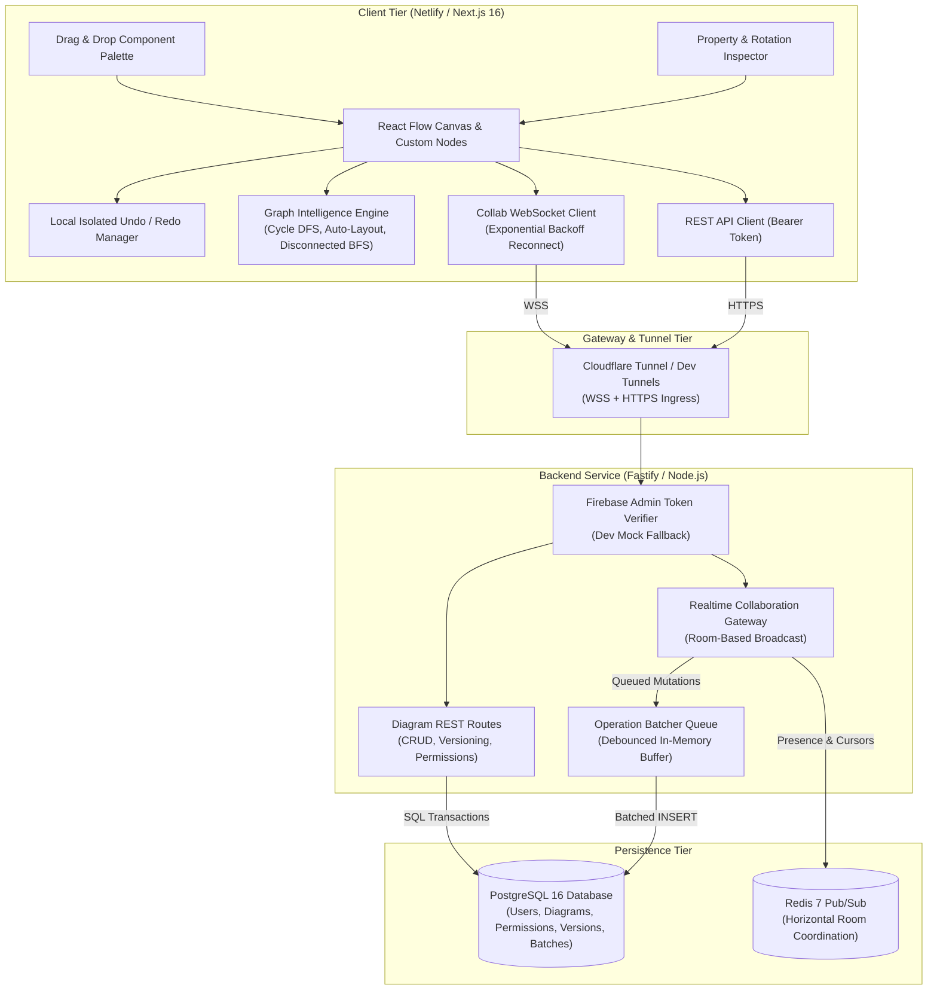
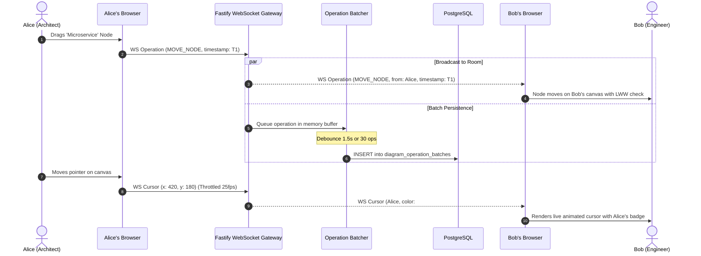
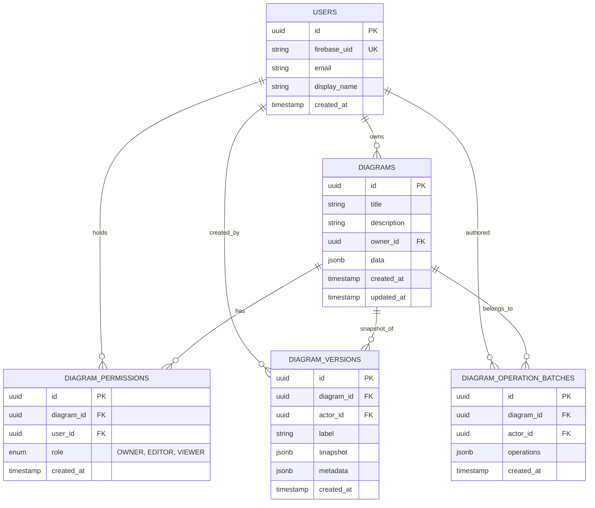

# Onelogica System Architecture

Onelogica is a real-time collaborative architecture and workflow designer designed for high concurrency, low latency, and graph intelligence.

---

## 1. High-Level Architecture

---

## 2. Real-Time Collaboration & Synchronization Workflow

The collaboration protocol uses room-scoped WebSockets (`/ws/diagrams/:diagramId?token=...`).

---

## 3. Dual-Layer Persistence Strategy (Edge Case 7)

To prevent lagging the user interface or hammering the database on every mouse movement, Onelogica implements a dual-layer persistence model:

1. **Fast-Path Operation Batching (Backend)**:
   - When a node is dragged or resized, fine-grained operation events (`MOVE_NODE`, `RESIZE_NODE`, etc.) are queued into `OperationBatcher`.
   - The queue flushes to `diagram_operation_batches` every 1,500ms or when 30 operations accumulate.
   - Zero database blocking during continuous drag interactions.

2. **Debounced Document Snapshot (Frontend)**:
   - After a user finishes editing, a 1,200ms debounce timer triggers a single `PUT /api/diagrams/:diagramId` snapshot save.
   - Stores the complete document graph (`nodes`, `edges`, `viewport`) in `diagrams.data` (JSONB).

---

## 4. Graph Intelligence Engine (Activity 3)

The diagram editor features an in-browser graph intelligence pipeline:

- **Topological Hierarchical Auto-Layout**:
  - Computes vertex in-degrees.
  - Identifies root sources and builds layer ranks via Breadth-First Search (BFS).
  - Aligns nodes into clean visual columns (default 280px layer spacing, 140px node spacing) and animates positions.
- **Cycle & Circular Dependency Detection**:
  - Directed graph Depth-First Search (DFS) maintains a recursion call stack.
  - If a backward edge is detected, reconstructs and displays the cycle path (e.g. `API Gateway -> Core Service -> Kafka -> API Gateway`).
- **Disconnected Subsystems Analysis**:
  - Undirected BFS partitions the graph into disjoint connected components.
  - Highlights isolated services that are missing upstream or downstream connections.
- **Connection Rules**:
  - Prohibits self-loops, duplicate edges, and dangling references to deleted nodes.
- **Grouping & Nested Components**:
  - Wraps multiple selected nodes into a parent boundary container node (`parentNode`, `extent: 'parent'`) and ungroups on demand.

---

## 5. Engineering Edge Cases & Resolution Strategies (Activity 6)

| Scenario | Challenge | Architectural Resolution |
| :--- | :--- | :--- |
| **1. Concurrent Node Movement** | Two users drag the same node simultaneously | **Element-level Last-Write-Wins (LWW)**: Each node carries a `lastUpdated` timestamp. When remote updates arrive, the mutation with the higher timestamp takes precedence without resetting the viewport. |
| **2. Deletion vs. Connection Race** | User A deletes a node while User B connects to it | **Orphan Edge Pruning & Connection Validation**: Deleting a node prunes all incident edges locally and over the wire. The connection validator verifies both source and target existence before committing any edge. |
| **3. Disconnect for 30 Seconds** | Client drops network connection and reconnects | **Exponential Backoff & State Re-sync**: Socket reconnects with exponential backoff (1s, 2s, 4s, 8s, up to 15s). On `onopen`, client sends `sync-request`, server queries latest snapshot and replies with `sync-state`. |
| **4. 1,000+ Nodes & Connections** | Extreme scale diagram causing render degradation | **Performance Budget & Sub-quadratic Algorithms**: DFS cycle detection and topological layering execute in $O(V + E)$ linear time. Automated benchmark suite confirms full analysis on 1,000 nodes in under 250ms. |
| **5. Multi-User Undo / Redo** | User A undoes, risking rolling back User B's edits | **Isolated Local Command History**: Undo/Redo history stack only records actions initiated locally. Undoing reverses *only* the current user's local actions. |
| **6. Invalid & Circular Dependencies** | Accidental cycle loops or malformed connections | **Graph Safety Gate**: `validateConnection` and `wouldCreateCycle` run pre-commit checks and surface real-time warning badges. |
| **7. High-Frequency Mouse Movement** | Network and database congestion | **Dual Throttling**: Cursor updates are throttled to 25 FPS client-side; operations are batched in-memory and flushed to PostgreSQL every 1.5s. |

---

## 6. Database Entity-Relationship Model

